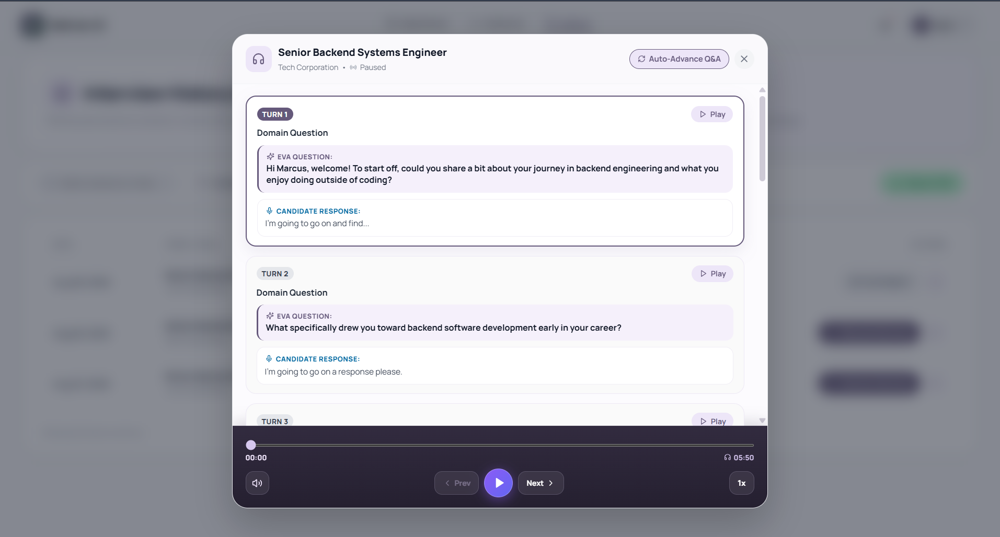
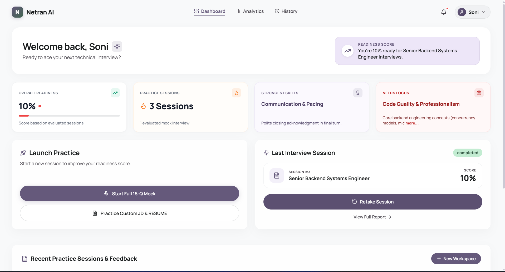
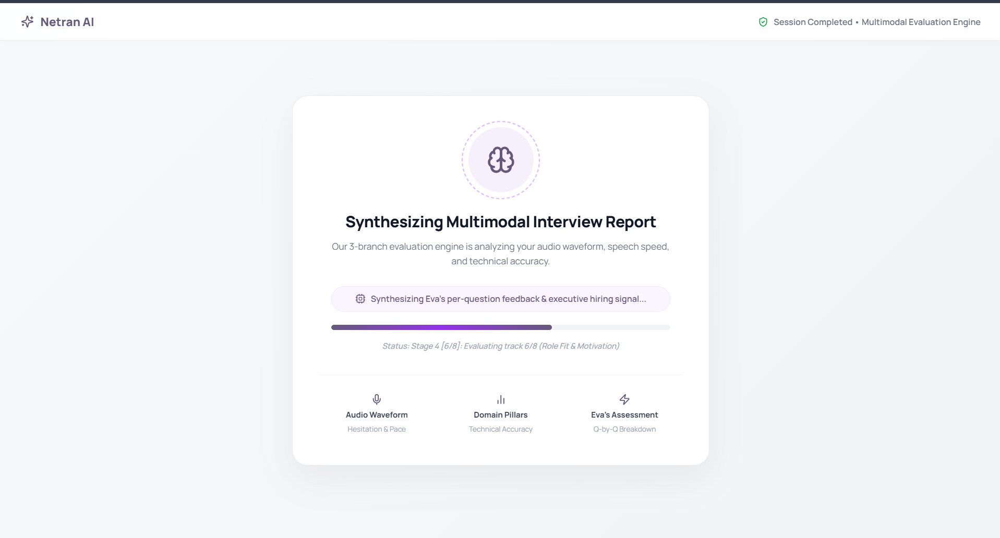
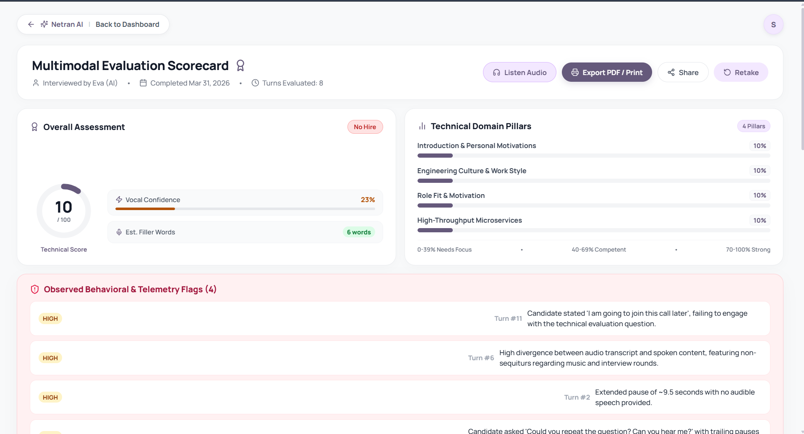
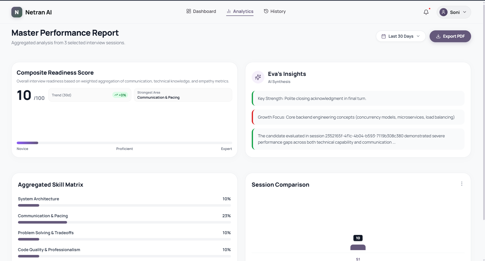
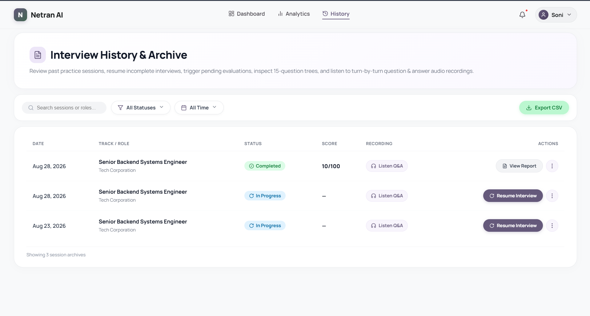

# Netran AI — Frontend Web Client

<div align="center">

[](https://react.dev)
[](https://vitejs.dev)
[](https://developer.mozilla.org/en-US/docs/Web/API/Web_Audio_API)
[](https://lucide.dev)
[](https://tailwindcss.com)

<p align="center">
  <b>Modern Single Page Application (SPA) delivering real-time, full-duplex conversational voice interviews, animated speaking avatars, interactive acoustic waveforms, and post-session performance analytics.</b>
</p>

[Screenshots](#-visual-interface--pages) • [Audio Architecture](#-real-time-audio-architecture) • [Pages & Routes](#-pages--routing-map) • [Setup & Development](#-setup--development)

</div>

---

## 📸 Visual Interface & Pages

<div align="center">

| Live Interview Room (`/interview/:id`) | Candidate Dashboard (`/`) |
| :---: | :---: |
|  |  |
| *Eva animated speaking avatar, dynamic volume bar, subtitles, and transcript tray* | *Personalized greetings, quick practice templates, and summary stats* |

| Evaluation Processing (`/processing/:id`) | Multimodal Report (`/report/:id`) |
| :---: | :---: |
|  |  |
| *Live Stage 4 pipeline progress and cross-verification status* | *3-Branch scores, acoustic metrics, question breakdowns, and audio playback* |

| Candidate Analytics (`/analytics`) | History Archives (`/history`) |
| :---: | :---: |
|  |  |
| *Score progression over time, pillar radar charts, and strength matrices* | *Searchable past interview records, duration logs, and report links* |

</div>

---

## 🎙️ Real-Time Audio Architecture

The frontend communicates with the FastAPI backend over a persistent full-duplex WebSocket connection (`/api/v1/voice/stream/{session_id}`):

```
┌────────────────────────────────────────────────────────────────────────────────┐
│                           BROWSER CLIENT (React 18)                            │
│                                                                                │
│   ┌────────────────────────┐                   ┌───────────────────────────┐   │
│   │   pcm-processor.js     │                   │   useInterviewSession.js  │   │
│   │ (AudioWorkletProcessor)│                   │   (React Lifecycle Hook)  │   │
│   │                        │                   │                           │   │
│   │ • Native OS 48kHz Mic  │  Float32 -> PCM   │ • WebSocket Connection    │   │
│   │ • Anti-aliased Boxcar  ├──────────────────►│ • AudioContext Manager    │   │
│   │   Decimation to 16kHz  │  Int16Array bytes │ • Playback Node Scheduler │   │
│   │ • Zero-copy ArrayBuffer│                   │ • State Machine Sync      │   │
│   └────────────────────────┘                   └─────────────┬─────────────┘   │
│                                                              │                 │
│                                                              │ Binary PCM /    │
│                                                              │ JSON Controls   │
└──────────────────────────────────────────────────────────────┼─────────────────┘
                                                               │
                                                               ▼
                                                  FastAPI WebSocket Gateway
                                               (/api/v1/voice/stream/{session_id})
```

### 1. Microphone AudioWorklet (`public/pcm-processor.js`)
- Runs on a dedicated browser audio rendering thread.
- Captures microphone input at the **native OS sample rate** (typically 48kHz or 44.1kHz), avoiding OS-level resampling distortions.
- Performs anti-aliased boxcar integer decimation down to standard **16kHz Int16 signed PCM**.
- Posts raw ArrayBuffers to the main thread with zero-copy transfers.

### 2. Session Hook & Playback Protocol (`src/hooks/useInterviewSession.js`)
- **Autoplay Handling**: Monitors `AudioContext` state (`suspended` vs `running`) and provides a single-click "Enable Audio" overlay for browser policy compliance.
- **Level 2 Playback Synchronization**:
  - Schedules Kokoro TTS 24kHz audio chunks sequentially using `AudioBufferSourceNode`.
  - Emits `{"action": "playback_event", "type": "playback_started", "turn_id": N}` when sound begins.
  - Emits `{"action": "playback_event", "type": "playback_finished", "turn_id": N}` when all queued audio drains.
  - Gathers client `DEVICE_INFO` metadata (sample rate, device label, platform) upon mic initialization for cross-device telemetry.

### 3. Animated Speaking Avatar (`src/components/AvatarEva.jsx`)
- Vector illustration with dynamic acoustic glowing ring animations.
- Modulates pulse speed and glow intensity based on speaking states (`IDLE`, `SPEAKING`, `LISTENING`, `THINKING`).

---

## 🗺️ Pages & Routing Map

| Route | Page Component | Description |
| :--- | :--- | :--- |
| `/` | `Dashboard.jsx` | Main candidate hub with KPI statistics, quick interview templates, and recent sessions. |
| `/setup` | `Setup.jsx` | Upload custom Resume (PDF/DOCX) & Job Description text, or select one-click templates. |
| `/interview/:id` | `Interview.jsx` | Full-screen live voice interview room with Eva avatar, real-time transcript, and timer. |
| `/processing/:id`| `Processing.jsx` | Animated loader showing Stage 4 multimodal evaluation progress across all 3 branches. |
| `/report/:id` | `Report.jsx` | Comprehensive report scorecard with audio player, pillar breakdowns, and strengths. |
| `/history` | `History.jsx` | Searchable list of past interviews, total scores, role targets, and retake actions. |
| `/analytics` | `Analytics.jsx` | Candidate growth telemetry, technical vs delivery skill charts, and performance trends. |
| `/settings` | `Settings.jsx` | Candidate profile name editing (`PATCH /auth/profile`) and password updates. |
| `/login` | `Login.jsx` | Secure JWT authentication login screen. |
| `/signup` | `Signup.jsx` | Candidate account registration screen. |

---

## 🎨 Design System & Iconography Standards

- **Color Palette**: Curated dark & light glassmorphic themes with deep indigo, slate, and vibrant purple accents (`#6366f1`, `#8b5cf6`, `#10b981`).
- **Typography**: Clean, modern geometric sans-serif typography (`Inter`, `system-ui`).
- **Vector Icons Only (Rule 12 Compliant)**: Standardized 100% on **Lucide React** (`lucide-react`) vector icons. No raw text emojis are used for structural UI elements or controls.

---

## 🛠️ Setup & Development

### 1. Install Dependencies
```bash
cd frontend
npm install
```

### 2. Start Development Server
```bash
npm run dev
```
The Vite development server will launch at **`http://localhost:5173`**.

### 3. Production Build
```bash
npm run build
```
Generates a minified, production-ready bundle in `dist/`.

### 4. Code Quality & Linting
```bash
npm run lint
```

---

<div align="center">
  <sub>Part of the Netran AI Autonomous Interview Platform.</sub>
</div>
